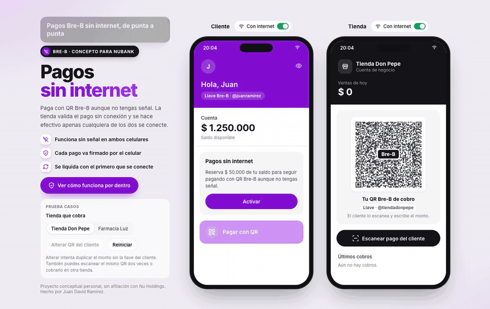

# Offline Payments Architecture

**Live demo:** https://juan-ramirez-dev.github.io/offline-payments-architecture/
**Inside view (animated backend):** https://juan-ramirez-dev.github.io/offline-payments-architecture/#por-dentro

A concept for QR payments that keep working when there is no signal on **either** side, the customer or the store. It is designed for a Bre-B style instant-payments network in Colombia.



## The problem

During blackouts, people had money in their banking app but couldn't pay at the corner store because neither phone had connectivity. Most "offline" payment schemes still need the merchant to be online to verify. This design doesn't.

## How it works

| # | Phase | Connectivity | What happens |
|---|-------|--------------|--------------|
| 1 | **Activate offline allowance** | Online | The bank reserves a small allowance in the ledger (e.g. COP 50,000, 3 payments, 48 h) and signs a certificate for the device's public key. The private key never leaves the phone. |
| 2 | **Scan the store** | Offline | The customer scans the store's QR. The app checks that the store certificate was signed by the bank's root key, which ships inside the app. |
| 3 | **Pay** | Offline | The phone signs `{store, amount, balance before/after, payment #, nonce, ts}` with ECDSA P-256 and encrypts it for that store only (ECDH + AES-256-GCM). |
| 4 | **Verify** | Offline | The store decrypts the payment, verifies the full signature chain against the root public key, and checks the rules (right store, not expired, payment count, balance). If a single peso is changed, the signature fails. |
| 5 | **Receipt** | Offline | The store returns a signed receipt. Both sides now hold proof of the payment. |
| 6 | **Settle** | Online (either side) | Whoever reconnects first uploads. Settlement is idempotent on `(allowance, payment #)`, so each payment is settled exactly once. Any double spend shows up at reconciliation, and unused allowance is released. |

### Key design decision: asymmetric signatures, not shared secrets

With a shared key, anyone who can verify a payment can also forge one, so the store would have to go online to verify. With a certificate chain (root, then device, then payment), the store can verify without being able to sign for anyone.

### Risk is bounded by design

- The allowance is reserved up front. Offline spending can never exceed it.
- There is a maximum number of payments and an expiry.
- A monotonic payment counter plus a nonce detect replays and double spends at settlement.
- Each payment is encrypted to a single store, so a payment intercepted at one store can't be redeemed at another.

## Reference backend (illustrative)

The "inside" view animates a reference architecture in an event-driven Clojure / Datomic / Kafka style:

- Root signing key in an HSM (AWS KMS)
- `offline-wallet` for reservations and device certificates
- `sync-gateway` to receive uploaded payments and receipts
- `settlement` + `ledger` for idempotent settlement
- `risk-engine` for double-spend and limit detection

Events: `offline.reserved`, `offline.receipt.uploaded`, `offline.settled`, `offline.conflict.detected`.

In production, device keys would live in hardware (Secure Enclave / Android StrongBox) with attestation (App Attest / Play Integrity).

## The demo

- Two phones side by side: the customer and the store. You can turn off each phone's internet independently.
- The cryptography is real: it runs in the browser with WebCrypto (ECDSA P-256, ECDH, AES-256-GCM, SHA-256).
- You can try tampering with a payment, reusing it, or paying the wrong store, and watch it get rejected.
- The `#por-dentro` view shows every message, field, and signature step by step alongside the backend.

## Run locally

```bash
npm install
npm run dev
```

Built with React, TypeScript and Vite. The site is deployed to GitHub Pages by [.github/workflows/deploy.yml](.github/workflows/deploy.yml).

---

Personal concept project by [Juan David Ramírez](https://github.com/juan-ramirez-dev). Not affiliated with Nu Holdings or Banco de la República. It uses no proprietary code or assets.
